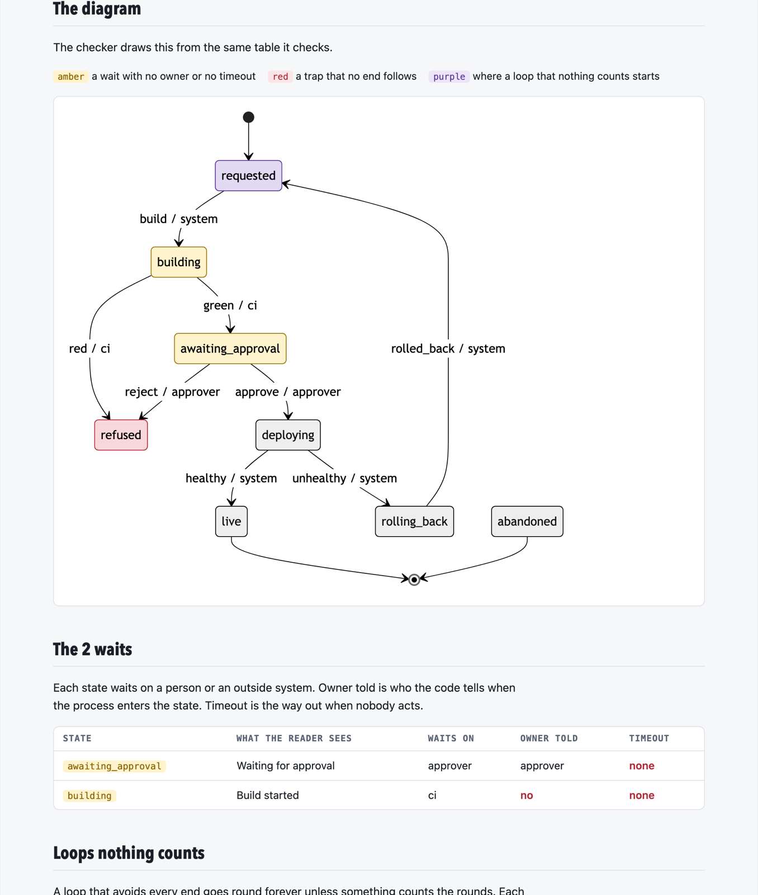
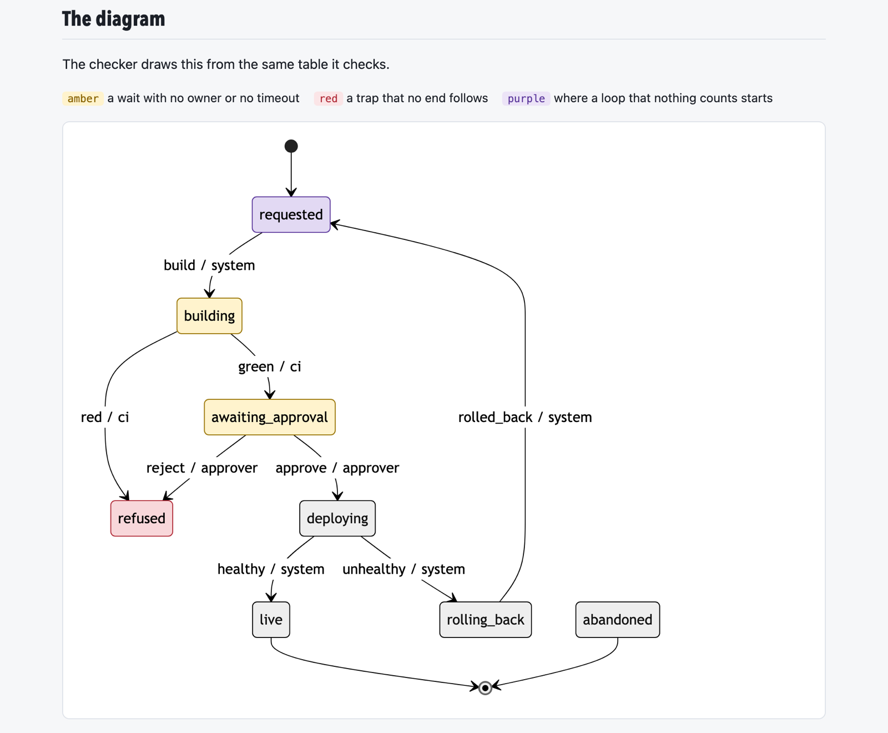
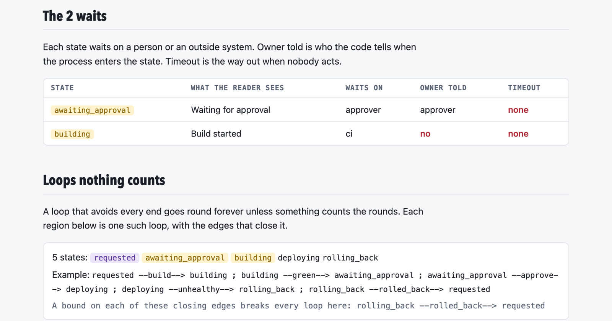
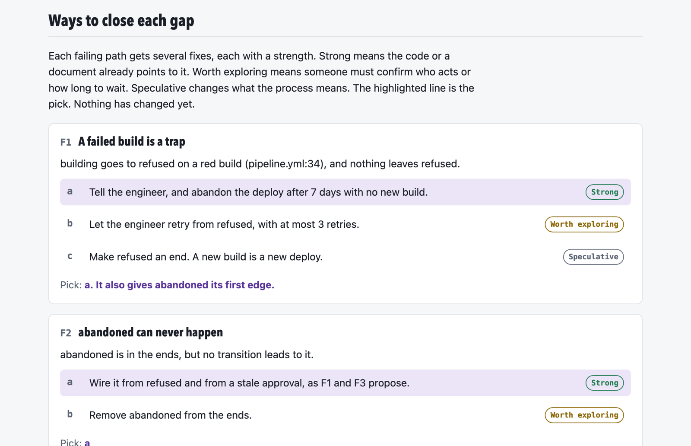
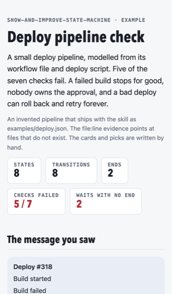

# skills

Agent skills by Miller Bath. One so far.

| Skill | What it does | Install |
|---|---|---|
| [show-and-improve-state-machine](skills/show-and-improve-state-machine/SKILL.md) | Models a process in a codebase or a document as a state machine, draws it, proves that every path ends in a known end state or lists the paths that do not, and offers ways to close each one. | `npx skills add bath/skills@show-and-improve-state-machine` |

## What show-and-improve-state-machine gives you

Every run ends with one HTML page. These pictures come from the example that ships with the skill, an invented deploy pipeline where a failed build stops for good, nobody owns the approval and a rollback can retry forever.

The page opens with the numbers and the seven checks, each in plain words.



The diagram comes from the same table the checker reads. Red marks a trap, amber a wait with no owner or no timeout, purple the start of a loop that nothing counts.



Below it, the waits and the loops are listed with what is missing.



Each failing path gets two to four ways to close it, rated Strong, Worth exploring or Speculative, with the agent's pick highlighted.



The page follows the system's light or dark theme and fits a phone.



To build this exact page yourself:

```
python3 skills/show-and-improve-state-machine/scripts/every_path.py report \
  skills/show-and-improve-state-machine/examples/deploy.json \
  --judgement skills/show-and-improve-state-machine/examples/deploy.judgement.json \
  --out deploy-report.html
```

## Layout

Each skill lives under `skills/<name>/` with its `SKILL.md`, scripts, references and examples. The first skill's checker is one Python file with no dependencies:

```
python3 skills/show-and-improve-state-machine/scripts/every_path.py check skills/show-and-improve-state-machine/examples/deploy.json
```

The tests for every skill run from the root:

```
python3 -m unittest discover -s tests
```

[`DECISIONS.md`](DECISIONS.md) records the defaults behind each skill and how to reverse them. The [`LICENSE`](LICENSE) is MIT.
